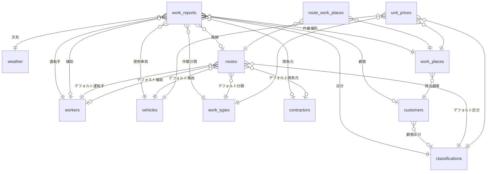

# SnowRemoval データベース定義書

## 0. ドキュメント情報

| 項目 | 内容 |
|------|------|
| プロジェクト名 | SnowRemoval (除雪業務管理システム) |
| 対象 | バックエンド DB スキーマ全体 |
| DB 種別 | PostgreSQL |
| ORM | Prisma 5.x |
| Source of Truth | `josetsu_console/prisma/schema.prisma` |
| 作成日 | 2026-06-22 |

## 1. はじめに

### 1.1 本書の目的

本書は除雪業務管理システム「SnowRemoval」のデータベース構造を、現場業務の文脈とともに記述するものである。テーブルの物理仕様 (カラム名・型・制約) に加え、**「そのテーブルは業務上の何を表しているか」「なぜそのカラムが必要か」**を明示する。

### 1.2 システム構成

```
┌────────────────────────┐
│ SnowRemoval (フロント) │   React + Vite
│ - 現場作業員が日報入力 │   Vercel ホスティング
│ - 管理者が集計・閲覧   │
└──────────┬─────────────┘
           │ /api/v1, /n8n
           ↓
┌────────────────────────┐
│ Cloudflare Tunnel       │   暫定構成 (quick tunnel)
│ - VPS への中継          │
└──────────┬─────────────┘
           │
           ↓
┌────────────────────────┐
│ josetsu_console (API)  │   Nuxt 4 + Prisma
│ - REST API 提供        │   VPS Docker 稼働
└──────────┬─────────────┘
           │
           ↓
┌────────────────────────┐
│ PostgreSQL             │  ← 本書の対象
└────────────────────────┘
```

**重要:** 物理的なテーブル定義は `josetsu_console` リポジトリ側にある。SnowRemoval (フロント) はこの DB を API 経由で操作する立場。本書はそれを SnowRemoval 視点でまとめたもの。

### 1.3 業務全体像

除雪請負業者が日々の作業 (除雪・排雪・薬剤散布等) を記録し、月末に請負元へ請求するための仕組み。

- **アプリ利用者 (worker)**: 現場の作業員。スマホ等から日報を入力。
- **Web 管理者 (administrator)**: 事務所側。日報の確認・修正・集計・出力。
- **記録対象**: 「いつ・誰が・どの車両で・どこを・どう作業したか」+ メーター読み・燃料・点検結果。
- **金額算出**: 車両 × 作業場所 × 作業分類 × 区分の組み合わせで決まる単価 (unit_prices) を、日報入力時にスナップショットとして保存。

## 2. テーブル全体像

### 2.1 ER 図 (主要関係のみ)



### 2.2 テーブル分類

| 分類 | テーブル | 役割 |
|------|---------|------|
| **トランザクション** | work_reports | 日報 (業務の中心データ) |
| **ユーザー** | workers | 現場作業員 (アプリログイン) |
| | administrators | Web 管理画面ログイン者 |
| **マスタ (単一概念)** | vehicles | 車両 |
| | work_places | 作業場所 |
| | customers | 顧客 (請求先) |
| | work_types | 作業分類 (除雪/排雪等) |
| | classifications | 区分 (県道/市道等) |
| | weather | 天気 |
| | contractors | 請負元 |
| **マスタ (組合せ)** | unit_prices | 単価 (条件組合せごと) |
| | routes | 路線 (ルートとデフォルト設定) |
| | route_work_places | 路線↔作業場所 中間テーブル |
| **システム** | operation_logs | 操作ログ |

### 2.3 共通の命名・制約規約

- **物理名**: snake_case (例: `work_reports`, `created_at`)
- **論理名 (Prisma モデル名)**: PascalCase (例: `DailyReport`)
- **主キー**: 全テーブル `id INTEGER` の SERIAL (自動採番)
- **タイムスタンプ三点セット (システム管理を除く)**:
  - `created_at` (DEFAULT NOW)
  - `updated_at` (Prisma の @updatedAt 自動更新)
  - `deleted_at` (NULL 許容、論理削除用)
- **削除はすべて論理削除**: 物理 DELETE は行わない方針。集計・参照整合性を維持するため。

## 3. テーブル詳細

### 3.1 work_reports (日報)

**業務的意味:** 1 日 1 作業者 1 現場の作業記録。現場アプリで作業員が記入し、事務所が確認・確定する。月末請求の元データ。

| カラム名 | 型 | NULL | デフォルト | 業務的意味 |
|---------|-----|------|----------|-----------|
| id | SERIAL | NO | AUTO | 内部 ID |
| work_date | DATE | NO | - | 作業日 (時刻なし) |
| start_at | TIMESTAMP | NO | - | 作業開始時刻 |
| end_at | TIMESTAMP | NO | - | 作業終了時刻 |
| removal_amount | DECIMAL(10,2) | YES | - | 除雪量 (トン)。任意記録項目 |
| applied_unit_price | INTEGER | YES | - | 適用単価のスナップショット。マスタ単価が後から変わっても請求済み日報の金額が変わらないよう、保存時点の値を凍結 |
| is_confirmed | BOOLEAN | NO | false | 事務所による確認済みフラグ。未確認は修正可、確認済みは原則ロック |
| weather_id | INTEGER (FK) | NO | - | 天気 → weather |
| worker_id | INTEGER (FK) | NO | - | 運転手 → workers |
| assistant_id | INTEGER (FK) | YES | - | 補助作業員 → workers。1人作業もあるため NULL 可 |
| car_id | INTEGER (FK) | NO | - | 使用車両 → vehicles |
| work_place_id | INTEGER (FK) | NO | - | 作業場所 → work_places |
| work_type_id | INTEGER (FK) | NO | - | 作業分類 → work_types |
| classification_id | INTEGER (FK) | NO | - | 区分 → classifications |
| contractor_id | INTEGER (FK) | YES | - | 請負元 → contractors。自社直営現場は NULL |
| route_id | INTEGER (FK) | YES | - | 路線 → routes。ルート外の単発作業は NULL |
| customer_id | INTEGER (FK) | YES | - | 顧客 → customers |
| snowfall_amount | INTEGER | YES | - | 当該作業地点の平均降雪量 (cm) |
| service_meter_start | DOUBLE | NO | - | サービスアワメーター 始業時の読み |
| service_meter_end | DOUBLE | NO | - | サービスアワメーター 終了時の読み |
| odometer_start | DOUBLE | NO | - | 走行距離計 始業時の読み (km) |
| odometer_end | DOUBLE | NO | - | 走行距離計 終了時の読み (km) |
| pre_operation_inspection | TEXT | NO | - | 始業点検結果。安全管理上の必須項目 |
| maintenance_details | TEXT | YES | - | 整備実施内容 |
| repair_details | TEXT | YES | - | 修理実施内容 |
| refueling_station | TEXT | YES | - | 給油した SS 名 |
| gasoline_amount | INTEGER | YES | - | ガソリン補給量 (ℓ) |
| diesel_amount | INTEGER | YES | - | 軽油補給量 (ℓ) |
| lubricating_oil_amount | INTEGER | YES | - | 潤滑油補給量 (ℓ) |
| hydraulic_oil_amount | INTEGER | YES | - | 作動油補給量 (ℓ) |
| remarks | TEXT | YES | - | 自由記述の備考 |
| tachometer_image_url | TEXT | YES | - | タコメーター撮影画像の URL |
| tachometer_notes | TEXT[] | YES | - | タコメーター確認メモ (配列。複数項目チェック対応) |
| created_at | TIMESTAMP | NO | NOW | - |
| updated_at | TIMESTAMP | NO | AUTO | - |
| deleted_at | TIMESTAMP | YES | - | 論理削除 |

**インデックス:**
- `idx_work_reports_work_date` (work_date) — 月次集計の主軸
- `idx_work_reports_worker_id` (worker_id) — 作業員別集計
- `idx_work_reports_car_id` (car_id) — 車両稼働分析

**運用上の注意:**
- `applied_unit_price` は**必ず日報作成時に確定値をコピー**して保存する。マスタ参照のみで請求金額を算出すると、単価改定時に過去日報の金額が遡って変わってしまう。
- `tachometer_notes` は PostgreSQL の TEXT 配列。フロントエンドでは複数チェックボックスの結果を配列として送る。

### 3.2 workers (作業員 / アプリ利用者)

**業務的意味:** 現場で除雪作業を実施する者。アプリにログインして日報を入力する。「補助作業員」も同じテーブル (役割は work_reports/routes 側で区別)。

| カラム名 | 型 | NULL | 業務的意味 |
|---------|-----|------|-----------|
| id | SERIAL | NO | - |
| worker_name | TEXT | NO | 表示名 |
| phone_number | TEXT | YES | 緊急連絡用 |
| login_id | TEXT | YES, UNIQUE | アプリログイン ID。NULL=ログインしない補助要員 |
| password | TEXT | YES | bcrypt ハッシュ。物理カラム名が `password` だが平文ではない |
| created_at / updated_at / deleted_at | - | - | 共通三点セット |

**運用上の注意:**
- カラム名が `password` だが、保存値は bcrypt ハッシュ。命名と中身が一致していないので外部公開・移管時に誤解されないよう注意。

### 3.3 administrators (Web 管理者)

**業務的意味:** 事務所の管理画面ログイン者。日報の確認・修正・帳票出力・マスタ管理を行う。現場作業はしない。

| カラム名 | 型 | NULL | 業務的意味 |
|---------|-----|------|-----------|
| id | SERIAL | NO | - |
| login_id | TEXT | NO, UNIQUE | Web 管理画面ログイン ID |
| password_hash | TEXT | NO | bcrypt ハッシュ (こちらはカラム名も正しい) |
| name | TEXT | YES | 表示名 |
| created_at / updated_at / deleted_at | - | - | 共通三点セット |

**workers との分離理由:** アプリ利用者と管理画面利用者は役割もアクセス権限も別物。混在させると権限管理が複雑になるため初期設計で分離済み。

### 3.4 vehicles (車両)

**業務的意味:** 除雪機械・トラック等の固定資産。除雪ドーザ、ホイールローダ、ダンプ等。

| カラム名 | 型 | NULL | 業務的意味 |
|---------|-----|------|-----------|
| id | SERIAL | NO | - |
| car_name | TEXT | NO | 車両名 (例: 除雪ドーザ1号) |
| car_brand | TEXT | NO | メーカー (例: コマツ、日立建機) |
| car_number | TEXT | NO | 車番 / 社内管理番号 |
| remark_name | TEXT | YES | 別名・備考 |
| created_at / updated_at / deleted_at | - | - | 共通三点セット |

### 3.5 work_places (作業場所)

**業務的意味:** 除雪対象のエリア・区間。1 つの顧客 (customers) が複数の作業場所を持つことが多い (例: 同一市役所が複数路線を発注)。

| カラム名 | 型 | NULL | 業務的意味 |
|---------|-----|------|-----------|
| id | SERIAL | NO | - |
| work_place_name | TEXT | NO | 場所名 (例: ◯◯町1丁目線) |
| customer_id | INTEGER (FK) | NO | 発注顧客 → customers |
| created_at / updated_at / deleted_at | - | - | 共通三点セット |

### 3.6 customers (顧客)

**業務的意味:** 除雪の発注元 (= 請求先)。市役所、町役場、建設会社、民間企業など。

| カラム名 | 型 | NULL | 業務的意味 |
|---------|-----|------|-----------|
| id | SERIAL | NO | - |
| company_name | TEXT | NO | 会社・団体名 |
| representative_name | TEXT | YES | 代表者名 (請求書宛名用) |
| pic_name | TEXT | YES | 担当者名 (連絡用) |
| address | TEXT | YES | 住所 |
| phone_number | TEXT | YES | 電話 |
| classification_id | INTEGER (FK) | YES | 顧客の主たる区分 → classifications |
| created_at / updated_at / deleted_at | - | - | 共通三点セット |

### 3.7 work_types (作業分類)

**業務的意味:** 作業の種類。単価計算と作業内容の集計に使う。

| カラム名 | 型 | NULL | 業務的意味 |
|---------|-----|------|-----------|
| id | SERIAL | NO | - |
| work_type_name | TEXT | NO | 分類名 |
| created_at / updated_at / deleted_at | - | - | 共通三点セット |

**想定マスタ値:** 除雪 / 排雪 / 排土 / 薬剤散布 / 車両点検 / 暖機運転 / その他

### 3.8 classifications (区分)

**業務的意味:** 除雪対象道路の管轄区分。請求先や単価の決定要因。

| カラム名 | 型 | NULL | 業務的意味 |
|---------|-----|------|-----------|
| id | SERIAL | NO | - |
| classification_name | TEXT | NO | 区分名 |
| created_at / updated_at / deleted_at | - | - | 共通三点セット |

**想定マスタ値:** 県道 / 市道 / 町道 / 村道 / 民間 / その他

### 3.9 weather (天気)

**業務的意味:** 作業時の気象状況。安全管理と作業効率分析のために記録。

| カラム名 | 型 | NULL | 業務的意味 |
|---------|-----|------|-----------|
| id | SERIAL | NO | - |
| weather_name | TEXT | NO | 天気名 |
| created_at / updated_at / deleted_at | - | - | 共通三点セット |

**想定マスタ値:** 晴れ / 曇り / 雨 / 雪 / 吹雪 / みぞれ

### 3.10 contractors (請負元)

**業務的意味:** 元請会社等、自社が下請けとして入る場合の上位業者。直営現場では使わない。

| カラム名 | 型 | NULL | 業務的意味 |
|---------|-----|------|-----------|
| id | SERIAL | NO | - |
| contractor_name | TEXT | NO | 請負元名 |
| emergency_contact_number | TEXT | YES | 緊急連絡先 (夜間出動時用) |
| created_at / updated_at / deleted_at | - | - | 共通三点セット |

### 3.11 unit_prices (単価マスタ)

**業務的意味:** 請求金額の元になる単価表。「どの車両で・どこを・どんな分類の・どの区分の作業をしたら いくら」を表す 4 軸マスタ。

| カラム名 | 型 | NULL | 業務的意味 |
|---------|-----|------|-----------|
| id | SERIAL | NO | - |
| unit_price | INTEGER | NO | 単価 (円) |
| car_id | INTEGER (FK) | NO | 車両 |
| work_place_id | INTEGER (FK) | NO | 作業場所 |
| work_type_id | INTEGER (FK) | NO | 作業分類 |
| classification_id | INTEGER (FK) | NO | 区分 |
| created_at / updated_at / deleted_at | - | - | 共通三点セット |

**ユニーク制約:** `(car_id, work_place_id, work_type_id, classification_id)` — 同一条件で複数単価が存在しないことを保証

**運用上の注意:**
- 単価改定時は **論理削除 + 新規追加** とし、過去日報の `applied_unit_price` (スナップショット) は変更しない。
- 4 軸の組合せ数が増えるとマスタが肥大化しがち。実運用では現実的な組合せだけ登録する。

### 3.12 routes (路線)

**業務的意味:** 反復的に行う作業の「ルート + デフォルト設定」。例: 毎週水曜にこの車両でこの路線を回る、という運用パターンの雛形。日報入力時にこれを選ぶと、運転手・車両・作業分類等が自動で埋まる。

| カラム名 | 型 | NULL | 業務的意味 |
|---------|-----|------|-----------|
| id | SERIAL | NO | - |
| route_name | TEXT | NO | 路線名 |
| contractor_id | INTEGER (FK) | YES | デフォルト請負元 |
| worker_id | INTEGER (FK) | NO | デフォルト運転手 |
| assistant_id | INTEGER (FK) | YES | デフォルト補助 |
| car_id | INTEGER (FK) | NO | デフォルト車両 |
| work_type_id | INTEGER (FK) | NO | デフォルト作業分類 |
| classification_id | INTEGER (FK) | NO | デフォルト区分 |
| created_at / updated_at / deleted_at | - | - | 共通三点セット |

**作業場所との関係:** routes 自体には work_place_id を持たず、`route_work_places` 中間テーブルで複数作業場所を紐付ける。

### 3.13 route_work_places (路線 ↔ 作業場所)

**業務的意味:** 1 路線が複数の作業場所を含む N:M 関係を表す中間テーブル。

| カラム名 | 型 | NULL | 業務的意味 |
|---------|-----|------|-----------|
| route_id | INTEGER (FK) | NO | 路線 |
| work_place_id | INTEGER (FK) | NO | 作業場所 |

**主キー:** `(route_id, work_place_id)` の複合主キー

**削除挙動:** `ON DELETE CASCADE` — 路線または作業場所が物理削除された場合に中間レコードも消える。ただし運用上は論理削除を使うため発火しない設計。

**設計沿革:**
- 初期実装 (2026-01-15) では routes に work_place_id を直接持っていた
- 2026-06-03 のマイグレーションで中間テーブルに変更し、1 路線対複数作業場所に対応

### 3.14 operation_logs (操作ログ)

**業務的意味:** 監査ログ。誰がいつ何をしたかを後追いするためのシステム的記録。

| カラム名 | 型 | NULL | 業務的意味 |
|---------|-----|------|-----------|
| id | SERIAL | NO | - |
| timestamp | TIMESTAMP | NO | 発生時刻 |
| level | TEXT | NO | INFO / WARN / ERROR |
| trace_id | TEXT | YES | リクエスト追跡用 ID |
| user_id | TEXT | YES | 操作したユーザー ID |
| client_ip | TEXT | YES | クライアント IP |
| message | TEXT | NO | ログメッセージ |
| details | JSONB | YES | 詳細情報 (JSON) |

**他テーブルとの違い:** タイムスタンプ三点セットも論理削除も持たない。追記専用 (insert-only)。

## 4. 外部キー削除ポリシー一覧

| 親テーブル | 子テーブル | 親削除時の挙動 | 理由 |
|----------|----------|------------|------|
| weather | work_reports | RESTRICT | 日報が参照中の天気マスタは消せない |
| workers (運転手) | work_reports | RESTRICT | 日報のある作業員は消せない |
| workers (補助) | work_reports | SET NULL | 補助は退職後でも日報は残す |
| vehicles | work_reports | RESTRICT | 廃車後も実績は残す → 論理削除運用 |
| work_places | work_reports | RESTRICT | 同上 |
| work_types | work_reports | RESTRICT | 同上 |
| classifications | work_reports | RESTRICT | 同上 |
| contractors | work_reports | SET NULL | 取引終了した請負元名は消えてもよい |
| routes | work_reports | SET NULL | 路線廃止後も日報は残す |
| customers | work_reports | SET NULL | 取引終了顧客でも日報は残す |
| customers | work_places | RESTRICT | 作業場所がある顧客は消せない |
| routes | route_work_places | CASCADE | 中間テーブルは親と運命を共にする |
| work_places | route_work_places | CASCADE | 同上 |

**実運用方針:** マスタはすべて論理削除 (`deleted_at` 設定) で運用する。物理 DELETE は原則行わないため、上記制約はあくまで「事故防止」として機能する。

## 5. 主要業務フロー

### 5.1 日報作成フロー

```
1. 作業員がアプリにログイン (workers.login_id / password)
2. 「日報入力」を開く
3. 路線 (routes) を選択 → 運転手・車両・作業分類・区分がデフォルトで入る
4. 作業場所 (route_work_places 経由で routes に紐付く work_places から選択)
5. メーター・燃料・点検結果を記録
6. unit_prices から該当する単価を引き、applied_unit_price に保存
7. work_reports に INSERT (is_confirmed = false)
8. 事務所が確認 → is_confirmed = true
```

### 5.2 単価マスタ更新時の注意

- **既存単価レコードを UPDATE しない** (過去の applied_unit_price との整合性が崩れる懸念があるため、運用ルール上は更新しない)
- 新単価は別レコードとして追加し、旧単価は `deleted_at` で論理削除
- 過去日報の請求金額は `applied_unit_price` のスナップショットを使うので影響を受けない

## 6. 今後の検討事項

| 項目 | 現状 | 想定改善 |
|------|------|---------|
| `workers.password` カラム命名 | 命名と中身 (ハッシュ) が一致せず | 次回マイグレーションで `password_hash` にリネーム検討 |
| 単価履歴の表現 | 論理削除 + 新規追加 | `valid_from` / `valid_to` を持つ期間モデルに変更も選択肢 |
| operation_logs の保持期間 | 無制限 | 6 ヶ月～1 年で古い行をアーカイブ/削除する運用ジョブが必要 |
| JustDB 関連 | 過去経緯としてリポジトリに痕跡が残る場合あり | 現行 DB は PostgreSQL のみ。JustDB 連携コードがあれば撤去 |

## 7. 参照

- スキーマ本体: `josetsu_console/prisma/schema.prisma`
- マイグレーション履歴: `josetsu_console/prisma/migrations/`
- API 実装: `josetsu_console/server/api/`
- フロントエンド: 本リポジトリ `src/`
